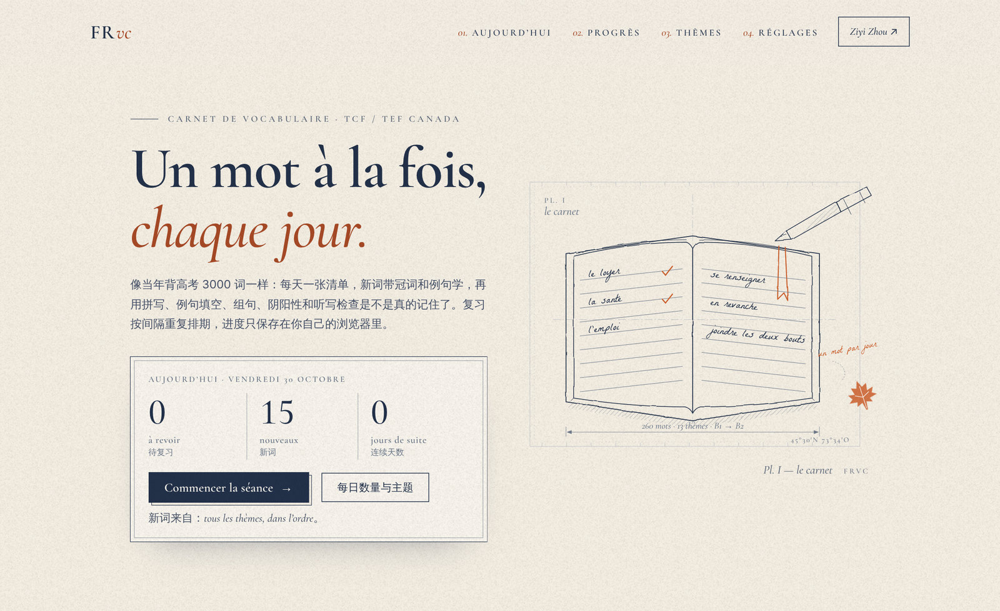
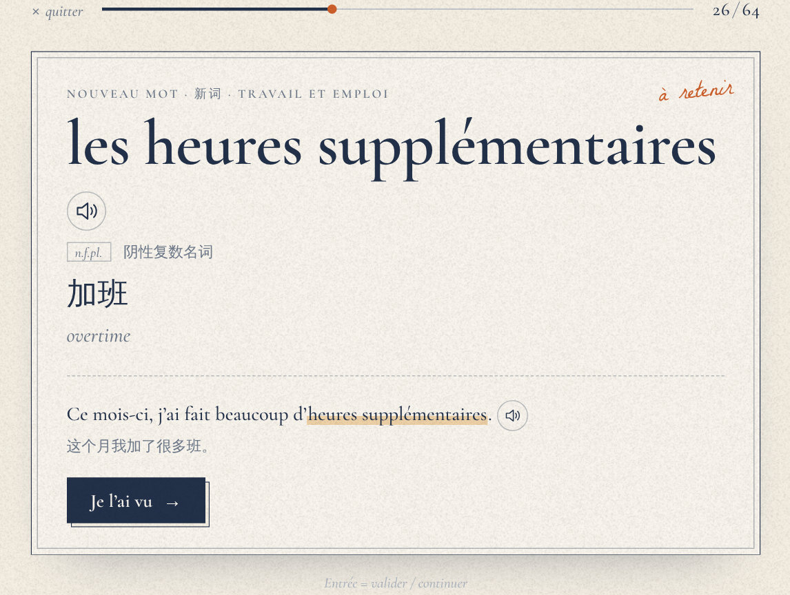
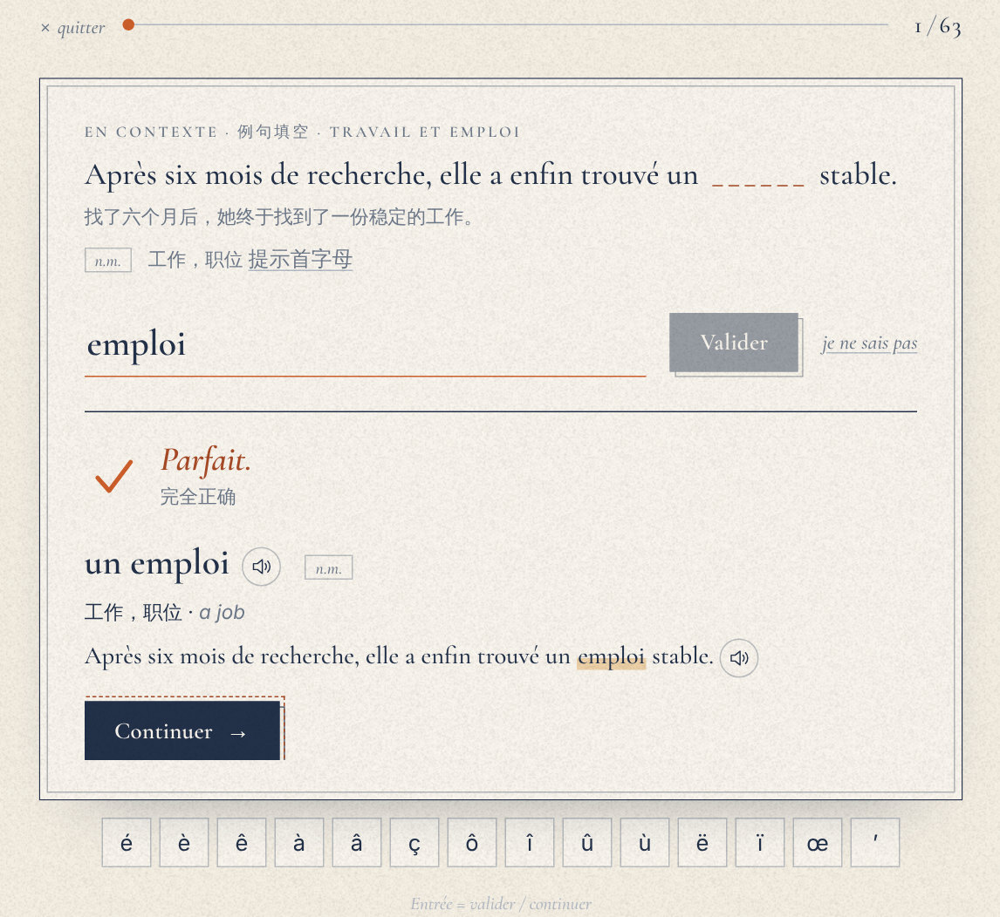
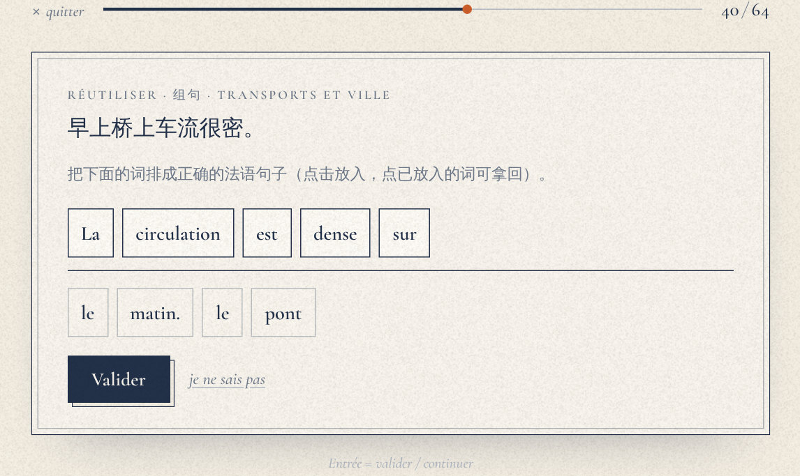
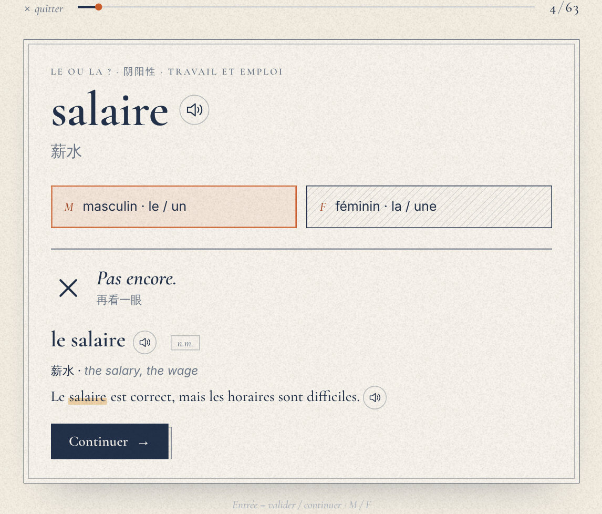
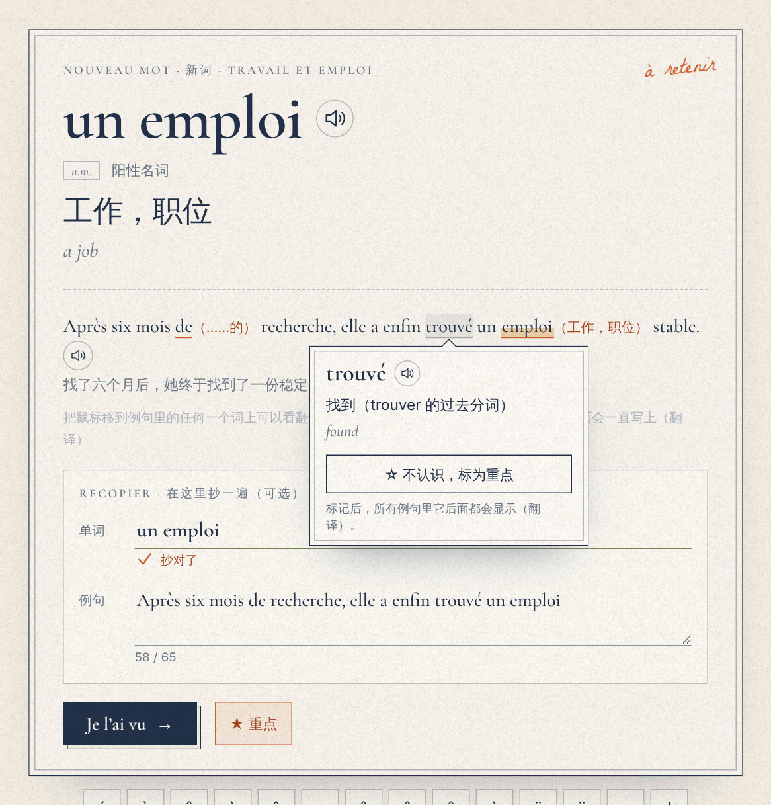
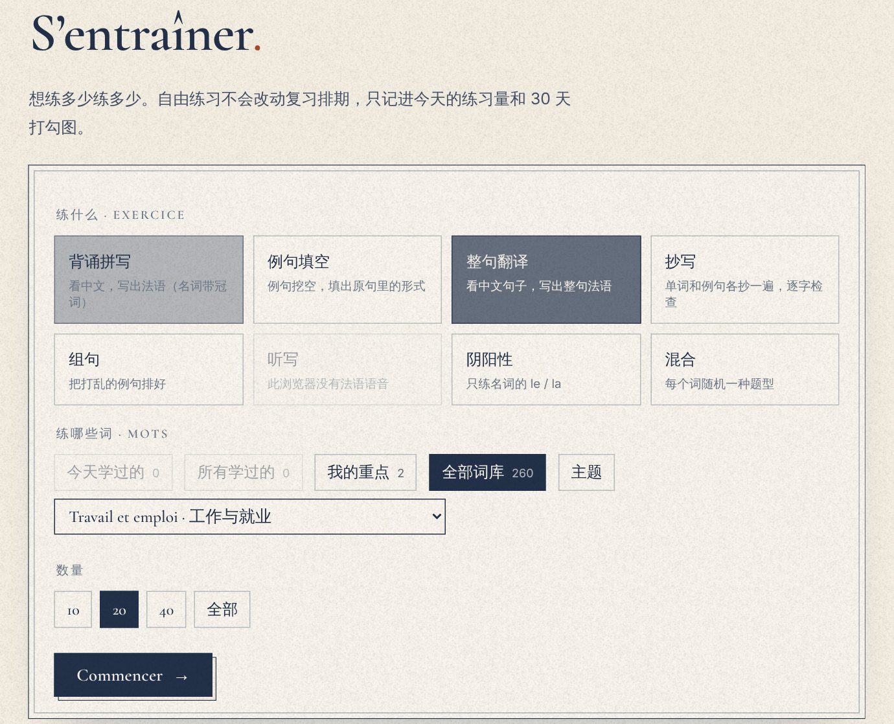
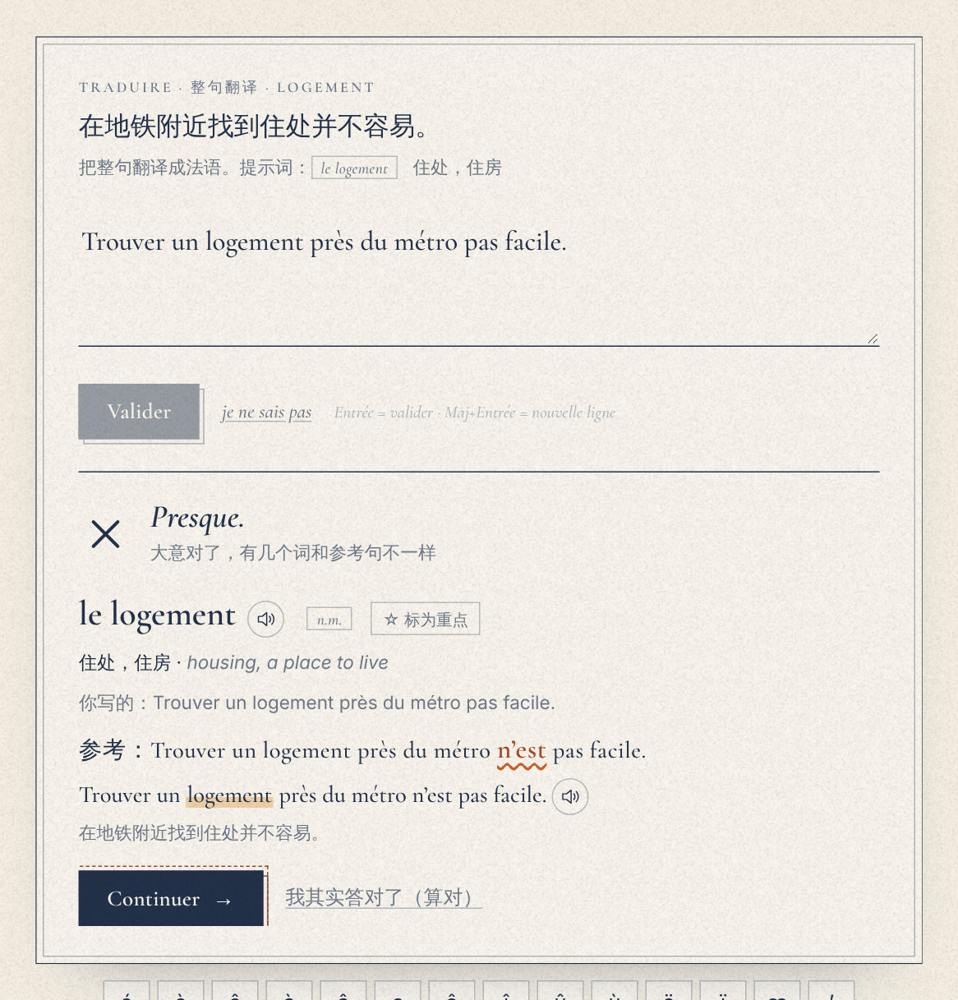
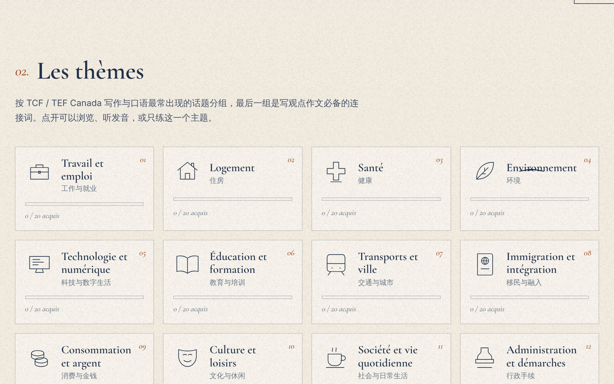

<div align="center">

# FRvc — Carnet de vocabulaire

**A daily French vocabulary notebook for the TCF Canada and TEF Canada.**

A static web app that hands you a list of words every day, teaches each one with its
article and an example sentence, and checks that you really know it: spelling, gender,
fill-in-the-blank, whole-sentence translation, copying, sentence building and dictation,
on a spaced-repetition schedule. Every word of every example sentence can be hovered for
its meaning and marked as one you do not know.

[](https://github.com/EllenSyuu/FRvc/actions/workflows/site.yml)


[](LICENSE)

**[Open the notebook](https://ellensyuu.github.io/FRvc/)** · [Why](#why) · [How a day works](#how-a-day-works) · [Exercises](#ways-to-check-a-word) · [Hover to translate](#every-word-hoverable-mark-what-you-do-not-know) · [Free practice](#free-practice) · [Answer checking](#answer-checking) · [The deck](#the-deck) · [Run locally](#run-locally)

</div>



## Why

Exam vocabulary is learned the way a Chinese high-school class learns its 3000-word list
for the gaokao: a fixed list, a fixed number of words a day, every word with an example,
and constant checking. Flash-card apps cover the review schedule but rarely the checking
the exam actually needs — writing the noun **with its article**, getting the **accents**
right, and **using** the word in a sentence.

FRvc does both. It is a single static page (HTML, CSS, ES modules) with no framework, no
build step, no account and no server: progress lives in the browser and can be exported
as a JSON file.

## How a day works

1. **The plan.** Every word due for review (oldest first), plus *N* new words in deck
   order (default 15, adjustable; restrict new words to chosen themes if you like).
2. **New words** come in groups of five: a word card (article, part of speech, Chinese
   and English, an example sentence, pronunciation), then a recognition question, then —
   after some reviews in between — a recall question that is graded.
3. **Reviews** pick an exercise to match how well the word is known: recognition while a
   word is young, production (spelling, dictation, sentence building) once it is settled.
4. **Misses** are asked again a few cards later (at most twice per session) and come back
   tomorrow.

The schedule is a Leitner system — the paper flash-card boxes, made exact:

| Box | 1 | 2 | 3 | 4 | 5 | 6 | 7 |
| --- | --- | --- | --- | --- | --- | --- | --- |
| Next review after (days) | 1 | 2 | 4 | 7 | 15 | 30 | 60 |

A right answer moves a word up one box, a wrong one sends it back to box 1. From box 5 on
a word counts as *acquis* (learned). The home page shows the box distribution, the last
30 days as a hatched sketch (denser hatching = more practice, a tick = the day's plan
finished) and the current streak.

## Ways to check a word

| | |
| --- | --- |
|  |  |
| **Découvrir** — the word card: article, part of speech, meaning, an original example sentence and the browser's French voice. | **En contexte** — the example sentence with the word blanked out. Asks for the form *as it appears* (conjugated, agreed), with a first-letter hint. |
|  |  |
| **Réutiliser** — rebuild the shuffled example sentence from its translation; the speaking and writing tasks reward exactly this. | **Le ou la ?** — the bare noun, masculine or feminine. Gender errors are among the most visible in written French. |

Plus **Rappeler** (see the meaning, type the French with its article), **Traduire**
(translate the whole example sentence from Chinese; missing or different words are
marked against the reference), **Recopier** (copy the word and the sentence, checked
letter by letter as you type), **Reconnaître** (four-way multiple choice in both
directions, distractors drawn from the same theme and part of speech) and **Dictée**
(listen, type; normal and slow speed). An on-screen row of
accented letters (é è ê à â ç ô î û ù ë ï œ ’) makes typing workable on any keyboard.
Every exercise type can be switched off in *Réglages*.

## Every word hoverable, mark what you do not know



Every word of every example sentence carries a gloss (900 forms, written for this deck,
with the dictionary form for conjugated verbs — *trouvé → trouver*). Hover a word, or tap
it on a phone, to see it. **☆ 不认识，标为重点** marks it: from then on, wherever that word
appears in any example sentence it is followed by its translation in brackets —
*Après six mois de（……的）recherche* — until you unmark it. Marking a card's own word
also puts that deck entry on the 重点 list.

New-word cards have an optional copying box: type the word and the example sentence out
once, and the first wrong character is pointed out as you type.

## Free practice



*Exercices* lets you drill as much as you like, outside the schedule: pick an exercise
(or *mixed*), the words — learned today, everything learned so far, **my key words**,
the whole deck or one theme — and how many. Words you marked inside sentences become
practice items of their own, with the sentence you found them in as the gap. Free
practice counts towards the day's activity but never moves the review schedule.



## Answer checking

`js/check.js` is a small pure module (no DOM) that tells kinds of mistakes apart instead of
returning right/wrong:

| Verdict | Example (expected → typed) | Counts as |
| --- | --- | --- |
| exact | `l'employeur` → `L’employeur` | right |
| accent | `la santé` → `la sante` | right, flagged — or wrong in **exam mode** |
| article | `le loyer` → `loyer` | wrong: *learn it with its article* |
| gender | `le loyer` → `la loyer` | wrong: *it is masculine* |
| typo | `déménager` → `déménnager` | wrong: *one letter away* |
| close | a sentence with ≥ 75 % of the reference words | wrong: *nearly — these words differ* |
| wrong | anything else | wrong |

Case, extra spaces, curly vs. straight apostrophes and `œ`/`oe` are normalised. `un` and
`le` (same gender) are both accepted. After a wrong answer the expected form is shown
with the wrong letters and the wrong accents marked separately. An *I was right*
button (我其实答对了) lets you overrule the checker when you typed a valid alternative.

## The deck

260 words and expressions in 13 themes — the topic areas that keep coming back in the
TCF and TEF Canada written and spoken tasks: work, housing, health, environment,
technology, education, transport and the city, immigration and integration, money,
culture and leisure, daily life, administration, and a final set of connectors for
giving an opinion (*en revanche*, *par conséquent*, *bien que* …). Usage follows Canadian
and Québec French where it differs (*le courriel*, *le cégep*, *la garderie*,
*le stationnement*).



Every entry is one line in [`data/deck.js`](data/deck.js):

```js
['le bail', 'm', 'the lease (pl. les baux)', '租约',
 "Au Québec, beaucoup de [[baux]] se terminent le 30 juin.", '在魁北克，很多租约在6月30日到期。'],
```

`[[…]]` marks the word inside the sentence, which is what the fill-in-the-blank asks
for. All example sentences, translations and glosses were written for this project. The
tests check that every entry is complete, every noun's article agrees with its gender,
every example has exactly one gap, no word appears twice, and every word of every
sentence has a gloss in [`data/glossary.js`](data/glossary.js) — so the deck can grow
safely towards a full exam list.

## Run locally

Any static file server works (ES modules do not load from `file://`):

```bash
git clone https://github.com/EllenSyuu/FRvc && cd FRvc
python3 -m http.server 8000      # then open http://localhost:8000
npm test                         # Node ≥ 20; no packages to install
```

```
index.html          the page shell
css/style.css       the atelier look: ink on warm paper, hairlines, pen draw-in
js/app.js           views, the session engine and the six exercises
js/check.js         answer checking, sentence diff, copy check (pure, unit-tested)
js/gloss.js         hoverable sentences, key-word marks, bracketed translations
js/srs.js           Leitner schedule and the daily plan (pure, unit-tested)
js/store.js         progress in localStorage, JSON export / import
js/speech.js        pronunciation through the browser's speech synthesis
js/art.js           the drawn plate, theme icons, the 30-day sketch, the odd passing gull
data/deck.js        the vocabulary
data/glossary.js    a gloss for every word form in the example sentences
tests/              node:test suites for check.js, srs.js, the deck and the glossary
```

## Privacy

Nothing leaves the browser. There is no analytics, no cookie and no network request
apart from loading the page itself; pronunciation uses the voices installed on the
device. Clearing site data clears progress, so export it before switching devices.

## Design

The page is drawn in the same atelier style as [ellensyuu.github.io](https://ellensyuu.github.io):
blue-black ink and graphite on warm paper, hand-lettered notes, orange only for the maple
leaf and for what matters, strokes that ink themselves in on first view, and motion that
stops for `prefers-reduced-motion`. Type: Cormorant Garamond, Inter and La Belle Aurore,
self-hosted under the SIL Open Font License (see [`fonts/`](fonts/)).

## Roadmap

- Grow the deck towards a full B1–B2 exam list (verbs with their prepositions, false friends, NCLC 7 writing connectors).
- Installable offline app (PWA) and a reminder at a chosen time.
- Import a word list (CSV) to study your own vocabulary with the same exercises.
- Spoken answers through the browser's speech recognition, for the speaking tasks.

## License

Code and vocabulary data: [Apache-2.0](LICENSE) © 2026 Ziyi Zhou. Fonts: SIL OFL 1.1.

FRvc is an independent study tool. It is not affiliated with France Éducation
international, CCI Paris Île-de-France or IRCC.
